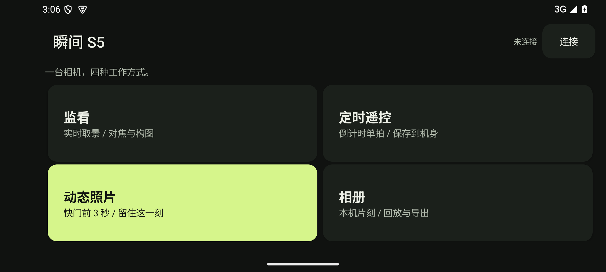

# 瞬间 Lumix / Moment

为 Panasonic LUMIX 系列相机打造的 React Native 实况照片应用。当前优先适配初代 S5 + OPPO Find X8；USB-C 数据线直连，不需要视频采集卡、不依赖云端、不刷机，后续可扩展其他机型。

Experimental Android Motion Photo companion for the original Panasonic LUMIX S5 over USB. Unofficial, MIT-licensed. **Physical S5 / Find X8 compatibility is not yet verified.**

[下载 v0.7.0 arm64 APK](https://github.com/USER-HFC/moment-s5/releases/tag/v0.7.0) · [MIT 许可证](LICENSE) · [测试范围](TEST_REPORT.md)

v0.7.0 修复三项拍摄页问题：相册支持双指缩放、单击显隐操作、删除 App 内副本，并直接返回拍照页；动态照片改为按下快门时冻结连续预录队列，不再先录未来 3 秒；相机照片索引在快门前准备，避免慢 USB 索引阻塞快门。相机 SD 卡原片和已导出系统相册副本不会因 App 删除而删除。

当前开发版是支持横竖屏的 React Native 应用，使用 React Native Paper，启动后直接进入拍摄页；相册从拍摄页进入，返回时回到拍摄页。动态照片会把相机原片和可选 LUT 渲染图同步到手机；LUMIX Lab 的 33-grid `.cube` 与包含它的 `.zip` 可导入本地 LUT 仓库。Android 发布包只提供 `arm64-v8a`，适合现代手机直装。

v0.5.8 修复 S5 拍摄后 JPEG 索引更新滞后导致的“未找到本次 JPEG”：事件端点和文件索引改为双通道轮询，并延长高分辨率原片接收等待；同时把真实失败原因同步到相册，不再把失败记录永久显示为“合成中”。**当前驱动仍限定初代 S5，改名不代表新增机型支持**。这是全新安装包，不兼容旧包 `cn.moment.s5` 的升级关系；如需清理旧版请手动卸载。iPhone / iPad 共用 RN 页面，原生相机桥仍待适配。



## 当前交付

- React Native Android APK，最低 Android 13（API 33）；双向横屏，左侧画面、右侧滚动操作区。`mobile/` 是 RN 工程，产品名为“瞬间 Lumix”。
- 监看：实时取景、构图网格开关、对焦控制；定时遥控：前台倒计时单张快门，仅保存到机身 SD 卡，不自动下载。
- Panasonic PTP USB 会话、实时 JPEG 取景、AF、近/远焦步进、曝光参数读取。
- 手机缓存快门前约 3 秒取景，App 快门触发 S5 拍照，再接收本次原尺寸 JPEG；不采集快门后画面。
- 原照片 + H.264 视频打包为 Android Motion Photo；保留原始 EXIF 与 JPEG 数据。
- 可选手机麦克风收音，AAC 音轨与视频合并。默认关闭，需要明确授予录音权限。
- LUT 仓库：导入 LUMIX Lab 33-grid `.cube` 或 `.zip`，启用后同时作用于监看帧和手机端渲染照片；`original.jpg` 永远保留相机原始 JPEG，`rendered.jpg` 是派生文件。LUT 必须匹配输入色彩空间，App 不会把普通 JPEG 自动变成 V-Log。
- 内置 8 个只读“Fuji 风格”LUT：Provia/Standard、Velvia、Astia、Classic Chrome、Classic Negative、Eterna、Acros、Pro Neg.Std。它们是本项目原创的非官方近似效果，适用于普通 SDR sRGB / Rec.709 取景与 JPEG，建议搭配相机标准照片风格；不是富士官方 LUT 或机内色彩的精确复现。生成脚本、许可与来源核查见 [NOTICE.md](NOTICE.md)。
- 最近照片全屏预览、双指缩放、单击显隐操作、长按播放、列表查看、删除 App 内副本、系统相册导出。
- 可运行的合成演示，用于无相机测试。演示拍摄、界面及元数据都明确标记，不伪装成机身输出。
- 连接诊断可分享，不记录机身序列号，不上传日志。

**状态：RN Release 可构建并在 Android 模拟器启动；尚未在真实 S5/Find X8 上验证 USB 会话、镜头控制、取景连续性和 ColorOS 相册识别。** iOS 页面工程已由 RN 生成，但 ImageCaptureCore/PTP 原生桥尚未接入，因此不能宣称 iPhone/iPad 已支持。Android Motion Photo 不能直接当作 Apple Live Photo。

详细验证范围与结果见 [TEST_REPORT.md](TEST_REPORT.md)，交互与视觉取舍见 [DESIGN.md](DESIGN.md)。

## 在 OPPO 上使用

1. 从 [v0.7.0 Release](https://github.com/USER-HFC/moment-s5/releases/tag/v0.7.0) 下载并安装 arm64 APK。这是开发测试签名，不是商店发行包；与旧版签名一致，可直接覆盖安装。
2. 手机设置搜索“OTG”并开启。使用支持数据的 USB-C to USB-C 线接 S5。
3. S5 选择 **PC(Tether)**、单张拍摄、JPEG 或 RAW+JPEG，确认 SD 卡可写。先用较短快门测试，例如 1/125s。
4. 打开 App 直接进入拍摄页，通过“连接相机”允许 USB 访问；顶部可打开动态照片、定时、LUT 和构图网格。
5. 打开顶部 **动态照片**，等取景缓存显示已就绪后点“拍摄动态照片”。按下快门时 App 会冻结已经缓存的前三秒并立即触发机身快门，不会再等待快门后的画面。在接收这张照片期间不要同时按机身快门或连接其他遥控软件。
6. 在拍摄页打开“相册”会直接预览最近照片；单击显示或隐藏操作，双指缩放，长按照片回放。列表中可切换旧照片；“保存到系统相册”写入 `DCIM/MomentS5`，删除只移除 App 内副本。
7. 如需声音，在“连接”页开启“录制手机环境声”。离开 App 后停止收音和连接；回来手动重连。

**定时遥控**：选择延时，点“开始倒计时”，可随时在指令发出前取消。离开页面、退到后台或 USB 拔出会取消尚未到点的任务；不支持后台定时、间隔连拍或自动重试。照片仅保存在机身，请在机身确认结果；本机相册不浏览相机存储卡。

没有相机时，在监看、定时遥控或动态照片页点“体验实况演示”。动态照片真实执行缓存、编码和导出，但使用程序生成的画面；定时遥控只显示模拟触发提示，不生成相机照片。

## 重要的能力边界

- **照片**来自 S5 本次 JPEG；RAW 留给机身保存，本版不下载或处理 RW2。程序不会主动删除相机中的文件。
- **动态**来自 USB 取景，最长边限制 960 像素、输出 15 fps。重复帧按真实时间显示，不表示机身提供了 15 个不同画面/秒。不是机内 4K 视频，也不是通过缓存补拍过去的 RAW。
- 动态截止于发出快门指令前的缓存快照，不是硬件曝光起始时间；Motion Photo 静态照片的时间标记位于视频最后一个编码帧。视频本身仅含取景帧，不会把原片插入视频。照片与动态的精确同步要在真机上校准。
- 拍照可能暂停取景，本版只使用快门前画面以避开该中断。预缓存未达到 3 秒或出现超过 500 ms 的帧间隔会阻止拍摄；App 不会用快门后的画面补录。仍显示最长帧间隔，不保证 USB 取景始终流畅。
- 音频来自手机，与 USB 画面共享单调时钟，但实际取景传输延迟仍需校准。收音失败会在日志中记录；缓存不足时导出无声版本。
- 以横向拍摄作为首次真机测试条件。竖拍静态 EXIF 原样保留，但机身取景方向与动态匹配尚未真机验证。
- “系统相册识别为实况”取决于 ColorOS 版本；App 内回放不依赖系统相册识别。社交软件可能只保留 JPEG，需要分别验证分享渠道。
- App 退到后台会关闭连接，不提供后台持续预录。合成期间请等当前照片完成；已下载的原片即使合成失败也会保留。
- 只支持一个进行中的实况任务；原片接收上限 64 MB，压缩 JPEG 环形缓存上限 32 MB。
- 近/远焦为镜头相对步进，非精确距离控制。A/B 可重复拉焦未实现，不能用近/远按钮冒充精确跟焦。

## 构建

环境：Node 18+、JDK 17、Android SDK Platform 35、Gradle 8.10.2。Paper、safe-area-context 和 document-picker 依赖由 `mobile/package-lock.json` 锁定。

安装 JDK 17 并配置 Android SDK（Android Studio 可代为安装），设置 `ANDROID_HOME` 或在不提交的 `local.properties` 中配置 `sdk.dir`。Windows 可执行：

```powershell
cd mobile; npm ci; cd android
.\gradlew.bat :app:assembleRelease :app:assembleAndroidTest
cd ..; npm test -- --runInBand
```

新机器可运行 `tools/bootstrap.ps1` 下载所需 Android 命令行工具。脚本只使用自己的工具目录，不改系统 PATH 或 JAVA_HOME；JDK 17 需已安装。完成后按输出指令接受 Android SDK 许可并构建。

### 设备媒体检查

```powershell
.\gradlew.bat :app:assembleDebug :app:assembleDebugAndroidTest
adb -s emulator-5554 install -r app/build/outputs/apk/debug/app-debug.apk
adb -s emulator-5554 install -r app/build/outputs/apk/androidTest/debug/app-debug-androidTest.apk
adb -s emulator-5554 shell am instrument -w cn.moment.lumix.test/cn.moment.lumix.DeviceChecks
adb -s emulator-5554 shell am instrument -w -e suite layout cn.moment.lumix.test/cn.moment.lumix.DeviceChecks
```

检查会创建明确标记的演示照片并导出一份到模拟器相册，覆盖 2.2 秒准备卡顿后的自动补帧、仅快门前 3 秒且不进行快门后取景、末帧时间标记、完整 CaptureEngine、原片尺寸、AVC 样本时间、视频解码、XMP 视频长度、AAC 合并与相册字节一致性。它不测试真实 USB。

`suite layout` 验证四入口、横屏监看、定时单拍及手动/导航/后台取消。`tools/ui-smoke.ps1` 只允许模拟器，执行连接错误提示、演示快门、相册回放、定时取消及小屏大字体截图；会在结束时恢复模拟器显示设置。可用 `-EvidenceDir` 单独保存各版本证据。

## 代码定位

| 文件 | 职责 |
| --- | --- |
| `UsbS5.java` / `Ptp.java` | USB 端点、PTP 容器、S5 指令、拍摄事件、原片接收 |
| `CaptureEngine.java` / `FrameRing.java` | 单任务拍摄、快门前缓存、错误保留、帧间隔测量 |
| `VideoEncoder.java` | JPEG 时间序列转 H.264，实际时间上的缺帧保持 |
| `AudioRing.java` / `AudioMux.java` | 可选 PCM 缓存、AAC 编码与复用 |
| `MotionPhoto.java` / `MomentStore.java` | 标准格式、本地存储、MediaStore 导出 |
| `mobile/App.tsx` / `mobile/src/native.ts` | React Native Paper 横屏界面与跨平台数据契约 |
| `mobile/android/.../MomentS5Module.java` | RN Android 原生桥、LUT 仓库和相册 URI |
| `MainActivity.java` / `PreviewView.java` / `HoldPhotoView.java` | 旧版 Android 界面，仅作迁移参考 |
| `ShareProvider.java` | 限定输出路径的只读分享 |

每次成功拍摄动态照片包含 `original.jpg`、`motion.mp4`、`MOMENT_MP.jpg`、`moment.json`；启用 LUT 时另有 `rendered.jpg`。静态原片与视频可独立分享，也保留后续转换到 Apple Live Photo 的素材基础；本版未提供该转换器。定时遥控不创建本机媒体文件。

## 开源来源

项目代码使用 [MIT 许可证](LICENSE)。第三方组件保留各自许可证；Gradle Wrapper 使用 Apache-2.0，见 [NOTICE.md](NOTICE.md)。本项目与 Panasonic / OPPO 没有官方关联。

相机协议适配自 MIT 许可的 [baku89/tethr](https://github.com/baku89/tethr)，固定参考提交和完整许可见 [NOTICE.md](NOTICE.md)。没有打包松下固件或闭源 SDK DLL。

Motion Photo 容器按照 [Android 官方格式](https://developer.android.com/media/platform/motion-photo-format)实现。USB 访问使用 [Android UsbManager](https://developer.android.com/develop/connectivity/usb/host)。

## 内置 Fuji 风格 LUT

拍摄页“LUT 风格”仓库提供 8 个 MIT 许可的内置预设：Provia / Standard、Velvia、Astia、Classic Chrome、Classic Negative、Eterna、Acros、Pro Neg.Std。列表以“内置”标注只读预设，随 APK 提供，不占用导入文件目录，也没有删除操作；自定义 `.cube` / `.zip` 仍通过“导入”加入本地仓库。“原色”关闭 LUT，内置与导入预设均作用于监看、快门前缓存和 `rendered.jpg`，相机原始 `original.jpg` 保留原样。

这些是原创的非官方近似效果，适用于普通 SDR sRGB / Rec.709 JPEG，建议使用机身标准照片风格。源码、每个预设的 SHA-256、来源核查和 MIT 许可见 [NOTICE.md](NOTICE.md)、`third_party/fuji-style-SOURCES.txt` 与 APK 资产中的 `luts/manifest.json`。可运行 `python3 tools/generate_fuji_style_luts.py --check` 检查生成结果，`python3 tools/check_bundled_luts.py --java-home /path/to/JDK17` 验证所有预设、实际资产加载、图像处理和 LUT 后示波器数据。

## 实时示波器

拍摄页工具栏的“示波器”可同时打开 RGB + 亮度直方图、亮度波形、RGB 分列和矢量示波器。每张半透明浮动卡片可拖动标题调整位置，点 × 单独关闭；本次 App 会话会记住打开的面板及位置，横竖屏切换后仍保持在取景区域内。演示模式同样提供实时数据，取景中断时会显示“取景暂停”。直方图还显示 RGB 通道触底 / 触顶的像素比例。

Android 在独立低优先级线程中分析与监看相同的 LUT 后 JPEG（内置或导入 LUT 均适用），最长边降采样至 256 像素，匹配当前 3:2 / 16:9 裁切及竖屏旋转，目标约 10 Hz；仅保留一个正在分析的帧。关闭所有面板、离开拍摄页或进入后台即停止分析，返回拍摄页可恢复本次会话。亮度与色差按全范围 JPEG 的 Rec.709 Y′ / Cb / Cr 计算，矢量图显示 75% 色标；这些是监看诊断，不是 RAW、机内曝光值或自动 V-Log 转换。没有新增 npm 依赖。

`cameraScopes` v1 事件提供四组 Base64 Uint8 数据：RGBY 直方图 4 × 256、波形 64 × 64、RGB 分列 3 × 32 × 64、矢量图 64 × 64。纯 Java 数学与采样节奏检查可用 JDK 17 运行 `sh tools/check-scopes.sh`；JS 解码、多个面板状态和订阅生命周期检查包含在 `cd mobile && npx tsc --noEmit && npx jest` 中。真实 S5 / 手机连续采样性能仍需实体设备验证。

### v0.8.0-beta.1 Wi-Fi 实验

**实验性 · 未经真机验证。初代 DC-S5 固件 2.9 尚未完成实体相机握手、取景、原片或射频验证，推荐使用 USB。** 连接面板默认 USB；切到“Wi-Fi（实验）”后，可输入相机 SSID / 密码由 Android 请求加入，或先在系统设置连接相机 Wi-Fi，再选择“已手动连接相机 Wi-Fi”并填相机 IP。默认 `192.168.54.1` 只是旧协议候选地址，以机身实际地址为准。SSID / 密码只用于本次系统请求，不写入日志或照片。

本版使用独立的 `CameraTransport`：USB 包装原有 `UsbS5`，实验 Wi-Fi 使用串行 `cam.cgi`、`getstate` 保活、独立 UDP 完整 JPEG 接收和 description 公布的 DLNA ContentDirectory。相机 HTTP / UDP socket 绑定到所选 Android `Network`，不绑定整个进程或替换默认互联网网络。应用的通用明文 HTTP 策略保持关闭；相机专用 socket 客户端另行强制同一相机私有 IPv4、校验公布的资源地址、拒绝重定向和控制指令资源。debug 的 Metro 例外仅限 localhost / 模拟器主机。

- 只实现候选 legacy `req_acc` 与设备名登记；机身须接受连接。Gen2 `req_acc_g` / `req_acc_e` 仅解析结构，报告“需要真机抓包确认”，没有移植 G9II 常量或响应算法。
- AF 使用 `oneshot_af`，MF 使用 `wide-slow` / `tele-slow`；只在只读能力探测明确声明后显示按钮。曝光仅展示可读的 `getsetting` 字段。
- 每次拍摄先取得完整分页目录基线，再单发快门。快门超时或拒绝后退出会话，**绝不自动重发**；请检查 SD 卡后重新连接。只接受唯一新对象中的 `CAM_ORG` / `CAM_RAW_JPG` 原 JPEG；多张新图、双卡歧义、缩略图或旧图均不能代替本次原片。请使用单张 JPEG / RAW+JPEG，避免机身或其他 App 同时拍摄。
- 原片流式写入临时文件，校验长度、JPEG SOI / SOF / SOS / EOI 后原子发布；随后沿用 LUT、三秒 pre-only 缓冲、编码、Motion Photo 和相册流程。完整连续三秒、帧间隔不超过 500 ms 的门槛由原生引擎强制执行。
- UDP 当前只接受含完整 JPEG 的单个 datagram，可识别有限长度的前缀。残帧被丢弃，有界队列最多三帧；未知应用分包格式须真机抓包确认。离开前台释放取景与网络，不进行后台拍摄。暂不包含 BLE 唤醒、自动发现或 iOS Wi-Fi 实现。

模拟器闭环只证明本项目自写 mock 与 App 的协议 / 媒体路径，不能代替真实 S5、Find X8、双 STA / 蜂窝共存、长曝光、双卡或原片 SD 字节一致性验收。证据见 [Wi-Fi beta 验证报告](evidence/v0.8.0-beta.1-wifi/REPORT.md)，实体测试清单见 [无线研究](docs/research/wireless-connection.md)。纯 Java 主机检查运行 `JAVA_HOME=/path/to/JDK17 bash tools/check-wifi.sh`；保留现有 core / native / scopes / LUT / Jest 与 `python3 -I -m unittest discover tools/s5-wifi` 检查。

debug APK 才显示“模拟相机调试”，也会在原生层拒绝 release 的任意主机设置。独立模拟器可使用 `10.0.2.2:18088`、UDP `49152`，运行 `python3 -I tools/s5-wifi/mock_camera.py --http-port 18088 --ssdp-port 11988 --advertise-host 10.0.2.2`；向指定模拟器执行 `adb -s emulator-5580 emu redir add udp:49152:49152`。mock HTTP 仍只绑定 Mac loopback。详细复现命令在验证报告中。

**安装 beta 前先导出照片。** 本版使用与 v0.7.0 不同的开发签名密钥：原密钥不可用，当前 `~/.android/debug.keystore` 于 2026-10-14 创建。因此不能覆盖安装旧版，须先把 App 内照片保存到系统相册，再卸载旧 App、安装 beta；卸载会删除 App 内照片和导入的 LUT，SD 卡原片和已导出的系统相册副本保留。本分支只准备版本 `0.8.0-beta.1` / code `22`，未推送、打 tag 或发布。
